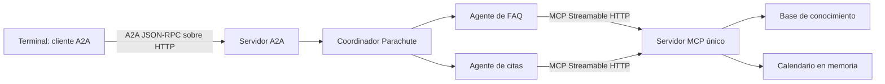

# HDT 7 — Protocolos agénticos

Implementación para Parachute, S. A., basada en el código de HDT-6. Conserva las FAQ y el calendario, separa la atención en agentes especializados y expone el conjunto mediante los SDK oficiales de MCP y A2A. Funciona sin API keys.

## Ejecutar

Requisito: Node.js 22 o superior y npm. Desde esta carpeta:

```powershell
npm.cmd ci
npm.cmd test
```

Abre **tres terminales**, todas dentro de `HDT-7`, y ejecuta en este orden:

| Terminal | Comando | Función |
| --- | --- | --- |
| 1 | `npm.cmd run mcp` | Servidor de herramientas MCP, puerto 3001 |
| 2 | `npm.cmd run a2a` | Servidor A2A y sistema multiagente, puerto 3000 |
| 3 | `npm.cmd run client` | Cliente A2A interactivo |

En la tercera terminal escribe, por ejemplo:

```text
¿Cuál es su horario de atención?
Agendar cita el 2026-10-19 a las 10:00 para asesoría.
Agendar cita el 2026-10-19 a las 10:00 para asesoría.
¿Con cuánto tiempo puedo cancelar una cita?
salir
```

También puedes ejecutar `npm.cmd run demo` con ambos servidores activos para enviar automáticamente esos cuatro mensajes. La primera reserva se confirma y la segunda se rechaza por duplicada si ese horario estaba libre al iniciar. Reinicia el servidor MCP para vaciar el calendario antes de repetir la demostración. Detén cada proceso con `Ctrl+C`.

Para una consulta individual:

```powershell
npm.cmd run client -- "¿Cuál es su correo de contacto?"
```

## Arquitectura



El **coordinador** delega primero al agente FAQ para conservar la prioridad de las políticas de cancelación/reprogramación de HDT-6. Si no encuentra una FAQ y detecta una intención de reservar, delega al **agente de citas**, que extrae fecha, hora y motivo y solicita la reserva por MCP. El **agente FAQ** obtiene la información mediante una herramienta MCP. Los especialistas tienen responsabilidades y métodos separados; la coordinación es interna al servidor, y A2A expone una sola identidad externa.

Los agentes mantienen el comportamiento **determinista basado en reglas** del proyecto original. No se añadió un LLM. La terminal solo importa el cliente A2A: no importa los agentes ni las herramientas. El coordinador y los especialistas tampoco importan el calendario o la base de conocimiento; los consumen por HTTP a través del cliente MCP.

## Requisitos de la hoja

| Requisito | Implementación |
| --- | --- |
| Un solo servidor MCP para las herramientas | `src/mcp-server.js`: `knowledge_search_faq` y `calendar_create_appointment` |
| Transporte Streamable HTTP | Endpoint `POST http://127.0.0.1:3001/mcp`, SDK MCP oficial |
| Servidor A2A que envuelva el sistema multiagente | `src/a2a-server.js`, coordinador y dos especialistas en `src/agents.js` |
| Un agente externo con sus skills | Agent Card con habilidades `faq` y `appointments` |
| Terminal como cliente A2A | `src/cli.js` y `src/a2a-client.js`, SDK A2A oficial |
| Logs del servidor MCP por ejecución | Eventos JSON `tool.start`, `tool.end` y `tool.error` |
| Logs del servidor A2A | `message.received`, `agent.delegate`, `message.completed` y `message.error` |
| Video y repositorio | [Video de demostración](https://youtu.be/SubgKwZHeBw) y enlace del repositorio al final |

La hoja exige herramientas MCP. No exige publicar prompts ni recursos, por lo que el servidor anuncia únicamente las dos herramientas usadas por los agentes.

## Endpoints y configuración

| Servicio | Dirección predeterminada |
| --- | --- |
| MCP | `http://127.0.0.1:3001/mcp` |
| Salud MCP | `http://127.0.0.1:3001/health` |
| A2A JSON-RPC | `http://127.0.0.1:3000/a2a` |
| Agent Card | `http://127.0.0.1:3000/.well-known/agent-card.json` |
| Salud A2A | `http://127.0.0.1:3000/health` |

La implementación usa A2A **1.0** con `@a2a-js/sdk` 1.3.0 y MCP con `@modelcontextprotocol/sdk` 1.31.0. Las versiones resueltas están en `package-lock.json`. Los ejemplos Python de la hoja son referencias; el proyecto conserva JavaScript y usa los SDK equivalentes.

Variables opcionales: `MCP_PORT` para el servidor MCP, `MCP_URL` para su cliente dentro de A2A, `A2A_PORT` para el servidor A2A y `A2A_URL` para la terminal. Por ejemplo, si cambias MCP a 4001, define `$env:MCP_PORT = '4001'` en la terminal 1 y `$env:MCP_URL = 'http://127.0.0.1:4001/mcp'` en la terminal 2 antes de iniciar cada servicio.

MCP usa Streamable HTTP sin sesiones y con respuestas JSON. Esto sigue siendo Streamable HTTP; no es el transporte SSE antiguo ni stdio. Se crea un transporte por petición y el calendario permanece compartido dentro del proceso MCP.

## Pruebas

`npm.cmd test` inicia servidores HTTP reales en puertos libres y ejecuta 14 pruebas: Agent Card y habilidades, descubrimiento y validación de herramientas MCP, FAQ, creación y duplicación de citas, concurrencia entre clientes, prioridad de cancelación, datos incompletos, horarios, fechas imposibles, preguntas desconocidas, validación de consultas vacías o demasiado largas, terminal en un proceso independiente y error de conexión a MCP. No requiere servidores iniciados manualmente, servicios externos ni credenciales.

## Alcance y limitaciones

- El calendario vive en memoria y se borra al reiniciar MCP, como en HDT-6.
- Para reservar, incluye fecha y hora en el mismo mensaje. No hay memoria conversacional entre mensajes.
- Cancelación y reprogramación son consultas de política: el código original no implementa operaciones para modificar o eliminar reservas.
- El horario permite inicios desde 08:00 hasta 16:59 de lunes a viernes, en Guatemala (UTC−06:00). No modela duración, feriados ni prohíbe fechas pasadas.
- Las FAQ y `soporte@parachute.example` son datos de demostración heredados de HDT-6.
- Los servidores escuchan solo en `127.0.0.1`, sin autenticación, para la demostración local.
- A2A devuelve mensajes inmediatos; no anuncia streaming ni notificaciones push.

## Archivos

```text
src/
  a2a-server.js       Servidor, Agent Card y adaptador del coordinador
  a2a-client.js       Descubrimiento y envío mediante el SDK A2A
  cli.js              Interfaz interactiva y demostración automática
  agents.js           Coordinador y agentes especializados
  mcp-server.js       Registro y ejecución remota de las dos herramientas
  mcp-client.js       Cliente MCP con transporte Streamable HTTP
  tools/              Calendario y FAQ provenientes de HDT-6
  log.js              Logs JSON con fecha UTC y servicio
  runtime.js          Inicio y cierre de servidores
test/protocols.test.js Pruebas de integración
```

## Repositorio y entrega

Repositorio: [J05U3oAr/HDT-7-IA](https://github.com/J05U3oAr/HDT-7-IA).

Video de demostración: [Ver video de la HDT 7](https://youtu.be/SubgKwZHeBw).

Para obtener el proyecto en otro equipo:

```powershell
git clone https://github.com/J05U3oAr/HDT-7-IA.git
cd HDT-7-IA
npm.cmd ci
npm.cmd test
```

El `.gitignore` excluye dependencias, caché, logs y archivos `.env`. Los enlaces del repositorio y del video están disponibles arriba para la entrega.

## Referencias oficiales

- [Servidor MCP y conceptos](https://modelcontextprotocol.io/docs/2026-07-28/develop/build-server).
- [SDK MCP para JavaScript/TypeScript: servidor y Streamable HTTP](https://ts.sdk.modelcontextprotocol.io/server).
- [SDK oficial A2A para JavaScript](https://github.com/a2aproject/a2a-js).
- [Tutorial A2A indicado en la hoja](https://a2a-protocol.org/latest/tutorials/python/6-interact-with-server/).
